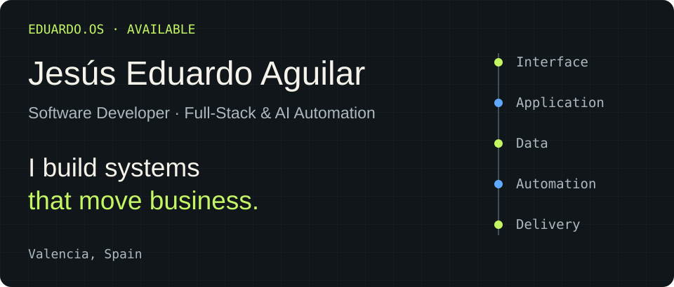
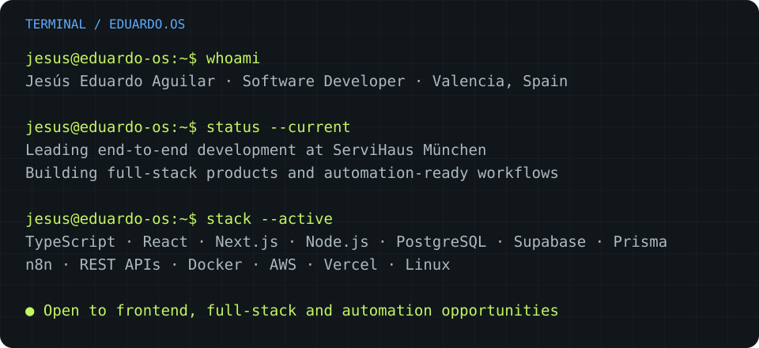
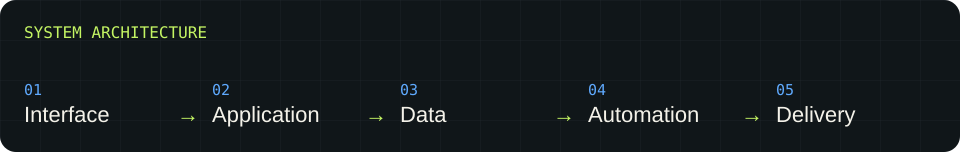

<picture>
  <source media="(max-width: 600px)" srcset="assets/header-mobile.svg">
  
</picture>

  
  
  

<picture>
  <source media="(max-width: 600px)" srcset="assets/terminal-mobile.svg">
  
</picture>

## From business needs to working systems

I'm **Jesús E. Aguilar**, a Software Developer based in **Valencia, Spain**. I turn real business needs into digital products, connecting interfaces, data models, APIs, automation and deployment. My work spans frontend and backend, with remote collaboration across international teams and clients.

## Selected systems

### 01 / ServiHaus München
**Service operations · Full-stack product ownership**

My current focus: leading the end-to-end development and deployment of a production service-management platform. It brings clients, employees, services, calendars, assignments, contracts, materials and operational tracking into one system, with authentication and dedicated experiences for administrators, employees and customers.

**Stack:** Next.js · TypeScript · Tailwind CSS · Prisma · Supabase / PostgreSQL · REST APIs · Vercel

[Explore ServiHaus München ↗](https://www.servihausmunchen.de/)

### 02 / Ayuda Sismo Colombia
**Emergency Response · Civic Technology**

A free community platform built to organize information and coordinate help after the earthquake in Colombia. Supports reports of people out of contact, lost and found pets, community updates and case closure, collection points, shelters, urgent requests and community responses. Image uploads, update timestamps and rate limiting support the reporting workflow.

**Stack:** Next.js · React · TypeScript · Tailwind CSS · Supabase

[Explore Ayuda Sismo Colombia ↗](https://ayudasismo-sandy.vercel.app/)

### 03 / KokiZeit
**Multilingual platform · Community & learning**

A board-game platform for Spanish-speaking families in Germany, with ES / EN / DE experiences, a game catalogue, reservations, events, tutorials and administration.

**Stack:** Next.js · React · TypeScript · Tailwind CSS · Supabase · i18next

[Explore KokiZeit ↗](https://kokizeit.com/)

### 04 / Grupo Médico del Chocó
**Healthcare · Institutional web design**

A responsive institutional website redesign that presents medical services and facilities, connects visitors through WhatsApp, and makes official financial documents accessible.

[Explore Grupo Médico del Chocó ↗](https://grupomedicodelchoco.co/)

## Tools arranged by purpose

<picture>
  <source media="(max-width: 600px)" srcset="assets/stack-mobile.svg">
  
</picture>

| Layer | Tools & approach |
| :--- | :--- |
| **Interface** | JavaScript · TypeScript · React · Next.js · Tailwind CSS · HTML · CSS |
| **Application** | Node.js · FastAPI · Prisma · REST APIs |
| **Data** | PostgreSQL · MySQL · Supabase · Firebase / Firestore |
| **Automation** | n8n · Webhooks · API integrations · AI-assisted workflows · LLM agent prototypes |
| **Delivery** | Git · GitHub · Docker · AWS · Vercel · Linux |
| **Practices** | SOLID · MVC · Microservices concepts · Agile / Scrum · Code reviews · Debugging · Production ownership |

## Current focus

- Owning the full product lifecycle at **ServiHaus München**, from interface and data modelling to deployment.
- Building automation workflows and prototypes with **n8n, APIs, webhooks and AI-assisted agents**.
- Exploring **frontend, full-stack and automation opportunities in Spain or remotely**.

## Professional journey

**September 2025 – Present · Lead Software Developer — Freelance** 
**ServiHaus München · Remote, Germany** 
End-to-end ownership of a service-management platform, its role-based experiences and production delivery.

My earlier work spans cloud and API integrations, technical support, React frontend development and international product teams. That journey shapes how I build today: understanding the operational problem, connecting the layers and taking responsibility for the result.

**Education:** Software Development Technologist — Universidad Tecnológica de Pereira

**Languages:** Spanish — Native · English — B2 · German — A2

---

### Let's build what's next.

Have a product to build, a system to improve or a workflow to automate? 
[**Start a conversation →**](mailto:jesus.dev8@gmail.com) · [Portfolio](https://portfolio-jesus-nu.vercel.app/) · [LinkedIn](https://www.linkedin.com/in/jesusaguilars/)
